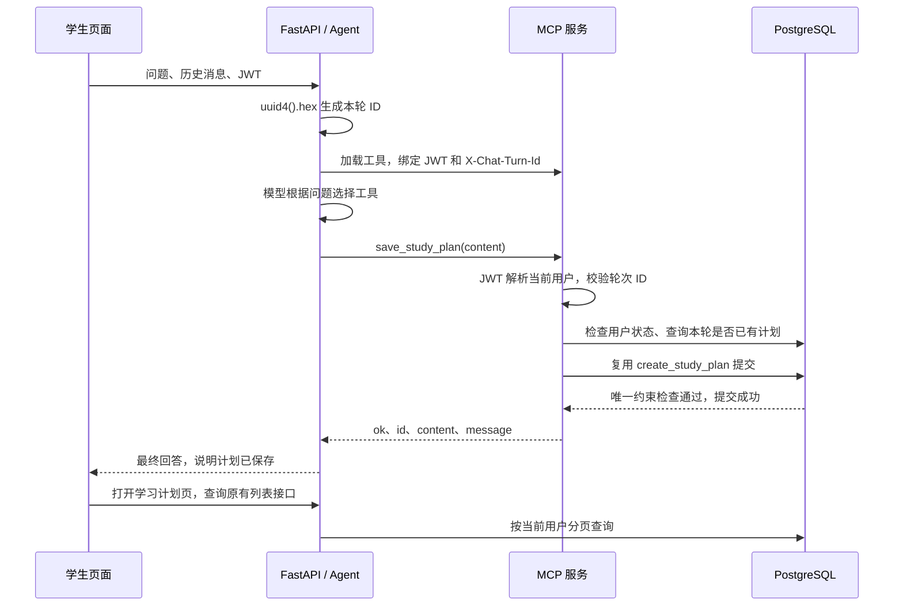

# 第 13 节：MCP 保存学习计划与整体联调

本文对应当前仓库实现。教程示例使用 MySQL 的 `study_plan`，本项目使用 PostgreSQL 的 `study_plans`，因此保留原表名并提供 PostgreSQL 迁移，避免历史计划丢失。

## 1. 完成后的行为

| 用户请求 | 预期行为 |
| --- | --- |
| 我明天有什么课？ | 查询当前学生课表 |
| 资料里的链表有什么特点？ | 检索全站共享资料，按片段作答并说明来源 |
| 帮我制定复习计划 | 返回计划文字，不写数据库 |
| 帮我制定复习计划并保存 | 生成正文，调用 `save_study_plan`，写入当前学生名下 |
| 把刚才的计划存下来 | 结合聊天历史取得完整正文，再调用保存工具 |
| 同一轮模型重复调用保存 | 拒绝重复写入 |

“工具调用结束”只代表调用返回。只有工具结果 `ok: true` 才能告诉用户保存成功；返回错误时必须如实说明。

## 2. 一次保存如何经过整个系统



模型只负责决定调用哪个工具、生成计划正文。身份来自 JWT，轮次来自后端生成的请求头，数据库负责最终约束。

## 3. Model：为什么需要 turn_id 和联合唯一约束

文件：`backend/app/models/study_plan.py`。

新增字段：

```python
turn_id: Mapped[str | None] = mapped_column(
    String(32), nullable=True, comment="MCP对话轮次ID"
)
```

`Mapped[str | None]` 表示 Python 中可以是字符串或 `None`；`nullable=True` 表示数据库允许 `NULL`。`uuid4().hex` 恰好返回 32 位小写十六进制字符串。

联合唯一约束：

```python
UniqueConstraint("user_id", "turn_id", name="uq_study_plan_user_turn")
```

它限制的是两个字段组成的组合：

| user_id | turn_id | 是否允许插入 |
| --- | --- | --- |
| 1 | aaaa… | 第一次允许 |
| 1 | aaaa… | 再次插入被拒绝 |
| 2 | aaaa… | 允许，不同学生互不影响 |
| 1 | bbbb… | 允许，是新一轮 |
| 1 | NULL | 允许多条，兼容手动保存 |

PostgreSQL 默认的唯一约束允许多个 `NULL`。本项目没有启用 `NULLS NOT DISTINCT`，所以手动保存仍可多次进行。

为什么先查询还需要约束？两个请求可能同时查询到“没有记录”，然后一起插入。只有数据库唯一约束才能在并发竞争时阻止第二次提交。Python 内存里的变量无法覆盖多个 MCP 进程，也无法在重启后保持状态。

## 4. Service：复用原来的业务逻辑

文件：`backend/app/services/study_plan_service.py`。

```python
def create_study_plan(
    db, current_user, data, *, turn_id=None
):
    ...
```

星号 `*` 表示 `turn_id` 只能用关键字方式传入：

```python
# 原有手动保存 API 无需修改。
create_study_plan(db, current_user, data)

# MCP 工具复用相同业务，再补充内部轮次信息。
create_study_plan(db, user, data, turn_id=turn_id)
```

两条入口共享以下逻辑：Schema 去除正文首尾空白、Service 拒绝空正文、限制最多 2000 字符、创建数据库记录、提交事务、读取返回对象。

`turn_id` 没有加到公开的请求 Schema 中。浏览器和模型都不需要提交它，原有学习计划接口的请求及响应结构保持兼容。

## 5. MCP 工具：按执行顺序理解保存函数

文件：`backend/mcp_server.py`。

### 5.1 模型只看到 content

```python
@mcp.tool()
def save_study_plan(content: Annotated[str, Field(...)]) -> dict:
    ...
```

`@mcp.tool()` 将函数注册为 MCP 工具。`Annotated` 和 `Field` 为工具参数提供类型及说明，模型加载工具时会收到这些信息。工具没有 `user_id`、`turn_id` 参数。

### 5.2 先验证当前用户

`_current_user_id()` 从 MCP HTTP 请求头读取 Authorization，再由现有 JWT 逻辑解析用户。错误凭证、已停用用户或已删除用户都不能继续保存。

随后在真正写入前再次查询 `User` 并检查 `status`，处理鉴权后用户恰好被停用或删除的情况。这不是用户状态变化与写入之间的严格串行锁，主要作用是在写入前重新确认有效性。

业务异常返回清晰提示；数据库等未知异常只记录日志，对模型返回通用错误，避免泄露连接信息、SQL 等实现细节。

### 5.3 校验轮次标识

```python
turn_id = (get_http_headers(include_all=True) or {}).get("x-chat-turn-id", "")
if not re.fullmatch(r"[0-9a-f]{32}", turn_id):
    return {"ok": False, "error": "缺少有效的对话轮次标识，请重新发起对话"}
```

HTTP 头名称不区分大小写，FastMCP 的依赖函数返回小写键。`fullmatch` 要求整个值都符合格式，不接受空值、超长值或非十六进制字符。

`include_all=True` 用来读取自定义的轮次请求头。这里检查的是格式，轮次值不是一个额外的认证凭证，身份安全仍由 JWT 提供。

### 5.4 查询已有计划，调用 Service

使用 `user_id` 与 `turn_id` 联合查询；已有记录时返回“本轮已保存”，否则创建新记录。`with SessionLocal() as db` 保证离开代码块时关闭会话；异常退出时释放事务资源，不能把关闭会话当作自动提交。

成功结果包含 `ok: true`、记录 ID、实际保存正文及说明。只有成功之后才算本轮保存完成。空正文、超长正文等写入前失败不会占用本轮 ID，修正后仍可重试。

### 5.5 为什么异常后还要开新 Session 查询

考虑以下情况：数据库已经提交成功，但网络连接在确认返回前断开。应用收到异常，用户数据却已经落库。若简单地再次插入，就可能重复保存。

处理方式：异常后用新 Session 查询同一 `(user_id, turn_id)`。

| 核对结果 | 返回含义 |
| --- | --- |
| 查到记录 | 本轮已有记录，提示去计划页核对 |
| 没有记录 | 报告保存失败，允许后续修正或重试 |
| 连核对也失败 | 返回“保存状态不确定”，本轮不要自动重试 |

这里也能处理并发请求触发的唯一约束异常。失败事务不能继续直接查询，因此使用新 Session。

## 6. Agent：同一轮必须复用同一个 ID

文件：`backend/app/services/agent_service.py`。

普通入口 `ask()` 和流式入口 `stream_ask()` 都调用：

```python
tools = await _load_mcp_tools(authorization, uuid4().hex)
```

`_load_mcp_tools` 创建 MCP 客户端时绑定：

```python
"headers": {
    "Authorization": authorization,
    "X-Chat-Turn-Id": turn_id,
}
```

这些工具后续调用继续使用同一组请求头。所以模型在一次回答中先查课表、再检索资料、再保存，或者意外重复保存，都属于同一轮。

不要在每次调用保存工具时生成新 ID，否则每次请求看起来都是新一轮，唯一约束就无法识别重复。

这里的“一轮”指一次 `/api/chat/ask` 或 `/api/chat/stream` 请求。浏览器重新发送请求会产生新 ID，因此本实现不提供跨 HTTP 请求重试的幂等性，也不会按正文内容去重。

SYSTEM_PROMPT 第 9～11 条分别约束：明确要求才保存、传入完整正文且成功后不再调用、失败时如实说明并处理不确定状态。

需要理解其边界：是否获得“明确保存”的意图由提示词引导模型判断，当前代码没有独立的确认状态机。数据库约束保证的是同轮记录唯一，不能保证模型永远正确理解用户意图。轮次头也可以被持有 JWT 的外部 MCP 客户端自行构造，因此它不承担用户授权的安全证明。

## 7. 课表与资料工具的错误处理

`get_my_schedules` 区分业务异常和未知异常，不再把原始异常拼接给模型。`search_course_docs` 增加鉴权未知异常处理。

对模型而言，下面两种结果含义不同：

```json
{"items": [], "count": 0}
```

这是成功查询但没有课程。

```json
{"error": "查询课表服务异常，请查看后端日志", "items": []}
```

这是查询失败，不能解释成没有课。资料检索也保留同样的区分，避免模型把服务故障解释成资料没有相关内容。

## 8. 数据库迁移与前端

迁移文件：`backend/migrations/003_study_plan_turn_id.sql`。脚本通过事务增加可空列和联合唯一约束，并检查列及约束是否已存在，可重复执行。当前本地 PostgreSQL 已执行该迁移。

`Base.metadata.create_all()` 只会创建缺失的表，不会自动给已有表增加字段。部署到其他旧数据库时，也必须执行迁移。新数据库由模型创建时已包含字段和约束。

前端原有浏览器标题、登录页名称、导航日历 Logo 已符合“校园课程智能助手”。新增 `frontend/public/favicon.svg` 并更新入口图标引用。聊天页补充三个工具的中文过程名称，并在欢迎语说明“明确保存后才写入”。

学习计划页继续调用原有列表、删除接口，无需新建页面或 API。

## 9. 验证与复现

在已安装依赖的 `timetable-backed` 环境中，从 `backend` 目录运行：

```powershell
python -m unittest discover -s tests -v
```

54 项测试覆盖原有 CRUD 和新增保存逻辑。新增测试验证了真实 JWT 下的学生隔离、无效轮次、停用用户、重复保存、数据库唯一约束、多次手动保存、内容修正后重试、提交后确认丢失、核对失败、工具参数 Schema，以及两个 Agent 入口生成独立轮次 ID。

原有资料 CRUD 测试已适配“空白资料无法入库”的当前逻辑，并隔离向量操作，避免测试修改业务 Chroma。

前端构建：

```powershell
cd frontend
npm run build
```

真实联调脚本：

```powershell
cd backend
python scripts/smoke_study_plan_agent.py
```

脚本依赖正在运行的 FastAPI、MCP、Chroma 和有效模型配置，会产生少量模型调用费用。它创建临时学生、课程、课表，通过真实 HTTP 验证普通问答不保存、流式调用三个工具后仅保存一条、MCP 同轮重复写入被拒绝、原有学习计划列表可见记录。无论断言成功或失败，都在 `finally` 清理本次临时业务数据；强制终止进程可能阻止清理，应避免中途强杀。

浏览器手动验收时，可以先说“请帮我规划明天的复习，不要保存”，确认计划页没有新增；再说“把刚才的计划保存下来”，确认出现 `save_study_plan` 调用并能在学习计划页查到正文。工具过程出现不代表业务成功，仍需核对最终工具结果和列表记录。

### 本次执行结果（2026-10-28）

- PostgreSQL 迁移已执行，确认 `turn_id` 列和 `uq_study_plan_user_turn` 存在。
- 54 项后端测试全部通过，前端构建成功；构建仍提示已有的大体积依赖分块警告。
- 真实模型与 HTTP 联调通过：普通聊天不保存、流式聊天调用三个工具并落库一条、同轮再次保存被拒绝、原有列表 API 可见记录。
- 临时学生、课程、课表及计划已清理；FastAPI 与 MCP 已重新启动并加载当前代码。
- 首次运行原有资料测试时发现其未隔离 Chroma，写入了占位向量。已修复测试隔离、删除确认的三个测试片段，并从现有 `实验报告二.docx` 原文件重建 13 个真实资料片段。
